# Solis voor Homey

Local control and monitoring of a **Solis** solar inverter with a **Homey Pro**, plus dashboards for the Mac, tablet, phone and TV (Kodi, Android TV, Apple TV).

Made by Wilfried van der Voort. The app and dashboards are in Dutch (an English translation is partly available).

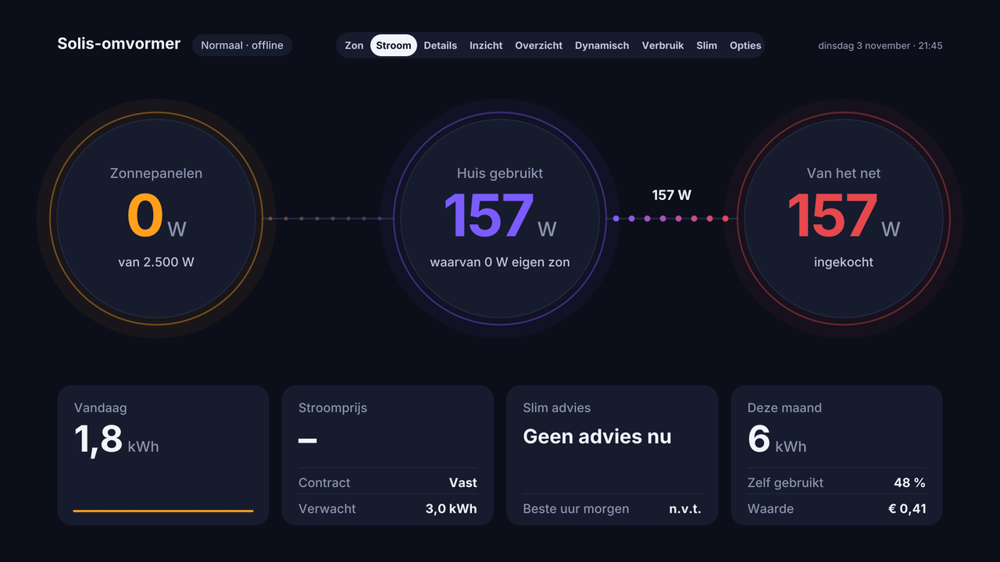

## What is in this repository

| Folder | What it is | Latest version |
| --- | --- | --- |
| `homey-app/` | The Homey app **Solis voor Homey** (zip, install with the Homey CLI) | 3.54.0 (v115) |
| `tv-apps/` | Android TV / Google TV app and Apple TV app that show the dashboard pages | Android 1.2.0, Apple TV v4 |
| `script.solis.dashboard/`, `repository.solis-1.0.0.zip` | Kodi / CoreELEC add-on, with automatic updates through the Solis repository | 2.6.0 |
| `screensaver.solis.dashboard/` | Kodi screensaver with the dashboard | |
| `beeld-server/` | Optional image server for Kodi display mode 2 | |

## Requirements: only the S2-WL-ST data logger

The app talks **locally** to the inverter over **Modbus TCP** (port 502). Of the Solis data loggers, only the **S2-WL-ST** offers Modbus TCP. Other sticks, such as the **S3-WIFI-ST**, only send data to SolisCloud and cannot be read locally, not even after a firmware update.

Why local and not the SolisCloud API? The cloud only delivers new values about every 5 minutes. Locally the app reads the inverter every 20 seconds (adjustable), so it can react straight away, for example limit the output the moment the price turns negative.

Tested with a **Solis S6-GR1P2.5K-M** (single phase, string inverter) and an S2-WL-ST on a Homey Pro. Other Solis string inverters with the same registers will probably work; testers are welcome.

Setup in short: give the data logger a fixed IP address in your router, then add the device in the app with that IP address, port 502 and ID 1.

## The Homey app

**Core (what most people want):**

- Read everything locally: power, voltage, current, temperature, frequency, DC values, yield today / month / total, status and alarm codes.
- Limit the output power (in watts) and switch the inverter on or off, from flows or automatically.
- Flow cards for faults, lost and restored connection, and more.
- Calm at night: the logger switches off without sun; the app sees the sun position and waits for the morning without false alarms.

**Extras (all optional, notifications can be switched off one by one).** Want only the core? Turn on **Alleen de basis** (Basics only) at the top of the settings: everything below is then switched off, except notifications for faults and a lost connection.


- Price steering: limit or switch off at negative or low prices. Hourly prices can come from **Power by the Hour** through a flow, or the app fetches them itself.
- Daily, weekly and monthly reports, morning summary with the expected yield based on the weather forecast.
- Warnings for faults, high grid voltage, high temperature, standby usage, and a sunny day with too little yield.
- "Good moment" advice to start the washing machine or dishwasher (solar surplus or cheapest hours).
- Savings jar, payback time, which contract would have been cheapest, this year versus last year, shade and dirt detection.
- Checks GitHub for a newer version and sends one notification when there is one.

**Good to know:**

- The inverter measures for itself and is not a calibrated meter. A MID-certified kWh meter (for example HomeWizard) on the solar group is more accurate.
- The app reports the inverter to Homey Energy as solar panels. If you also have a kWh meter on your panels, the generation is counted twice. On a Homey Pro (2023) you can exclude a device from Energy in its advanced settings.
- Since 3.43.0 the app keeps one connection to the logger open (fewer reconnects, fewer dropouts). A forum member reports that the S2-WL-ST does not upload to SolisCloud while a Modbus connection is open. If you rely on SolisCloud, check that it still updates.

### Install the Homey app

The app is not in the Homey App Store yet. You install it from a computer with the Homey CLI (Node.js needed):

1. Download `homey-app/Solis-voor-Homey-v115.zip` from this repository.
2. In Terminal: `npm install -g homey` and `homey login`.
3. Then: `unzip -oq Solis-voor-Homey-v115.zip -d app && cd app && npm install && homey app install`
4. In the Homey app: add a device **Solis** and fill in the IP address of the data logger, port 502 and ID 1.

## Dashboard on the Mac, tablet and phone

The app runs a small web dashboard on your own network: `http://HOMEY-IP:8765`. On a phone it switches to a phone layout with five tabs (Nu, Prijzen, Overzicht, Sparen, Meer). Add it to your home screen (iPhone: share button, "Add to Home Screen"; Mac: Safari, File, Add to Dock).

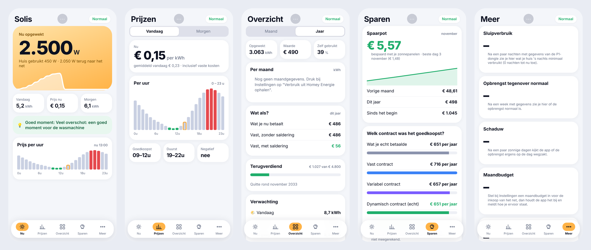

<details><summary>Dark mode</summary>

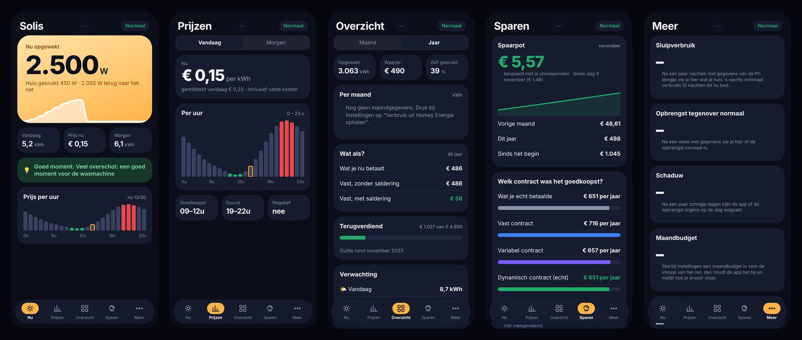

</details>

The same pages are drawn as images for the TV:

| Page | What you see |
| --- | --- |
| **Zon** (Sun) | Sun arc for today, output per hour, big live wattage, today / price / advice / month tiles |
| **Stroom** (Power) | Panels, house and grid as three rings with flowing dots, plus today's yield, price, smart advice and month totals |
| **Details** | Generation versus consumption over the day, today's score, hourly price chart, tracked appliances, CO2 savings |
| **Inzicht** (Insight) | Last 14 days, 3-day forecast, payback time, shade and dirt detection, feed-in value, charging tip |
| **Overzicht** (Overview) | Year totals, self-consumption, value of your solar power, month table, "what if" comparison, home battery estimate |
| **Dynamisch** (Dynamic) | Dynamic contract: hourly prices, cheapest and most expensive hours, what dynamic would cost you, smart shifting |
| **Verbruik** (Usage) | Consumption today, month and year, 30-day chart (own solar versus grid), hourly usage, appliances |
| **Slim** (Smart) | Standby usage, yield versus normal, shade, monthly budget, live cost per hour, grid voltage, end of net metering, goal streak, CO2 |
| **Opties** (Settings) | Read-only overview of the app settings |
| **Spaarpot** (Savings) | What your panels saved this month, last month, this year and in total, plus payback |
| **Vergelijk** (Compare) | Which contract would have been cheapest, and this year versus last year with the weather |
| **Morgen** | Tomorrow at a glance: expected yield and sun per hour, tomorrow's prices (dynamic contract) with when the inverter will block export or switch off, and tips for the washing machine and dishwasher |
| **Gas & water** | Gas and water use from the meters in Homey (e.g. Homey Energy Dongle and a water meter): today, yesterday, this month, 30-day average, costs and the last 14 days, plus a warning when water keeps flowing for an hour |

Which pages appear, and in which order, is set in the app under **Pagina's en volgorde**.

## TV apps (Android TV and Apple TV)

See `tv-apps/README.md`. In short:

- **Android TV / Google TV**: `tv-apps/downloads/Solis-AndroidTV.apk`. Install once with the Downloader app; after that the app updates itself (it asks, then shows the Android install screen).
- **Apple TV**: `tv-apps/downloads/Solis-AppleTV-v4.ipa` (unsigned, for an install service that signs it). It shows a message when a newer version is on GitHub.
- Left and right change page.
- New versions are announced in `tv-apps/versie.json`.

## Kodi add-on

A Kodi / CoreELEC add-on that puts the same dashboard on the TV. The Solis app on your Homey draws the pages as images; the add-on shows them full screen, refreshes them and lets you flip between pages with left and right on the remote.

<table>
  <tr>
    <td>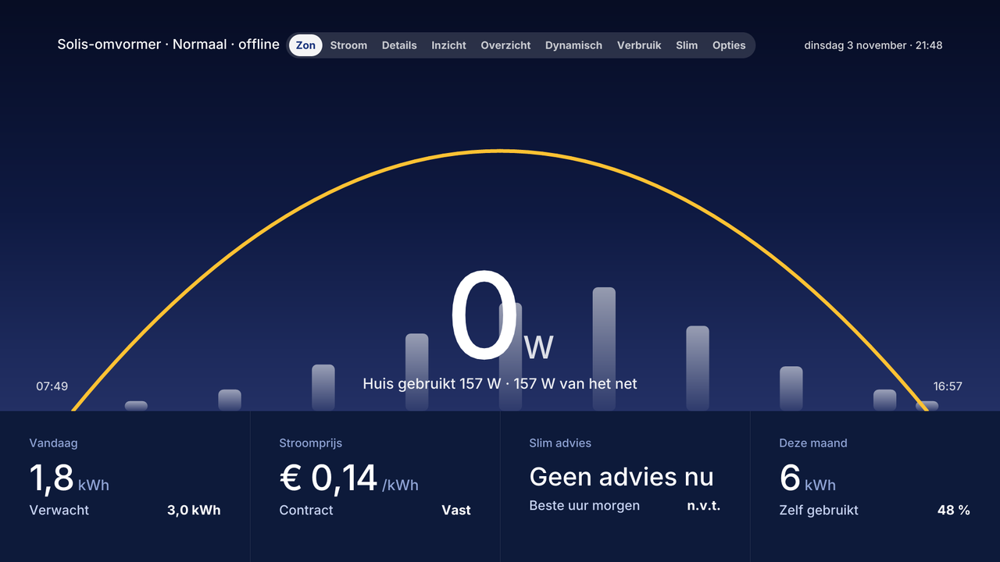</td>
    <td>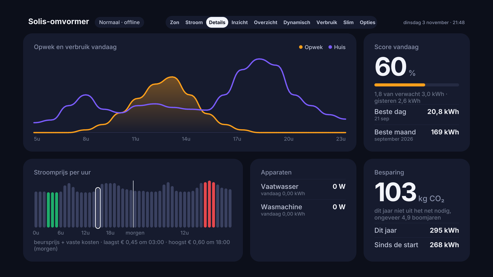</td>
  </tr>
  <tr>
    <td>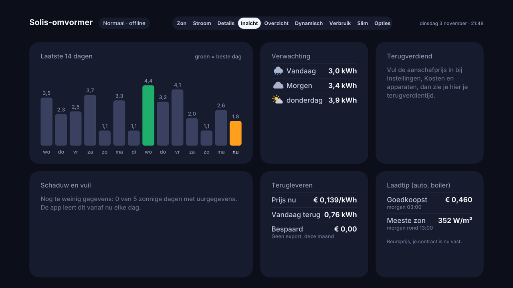</td>
    <td>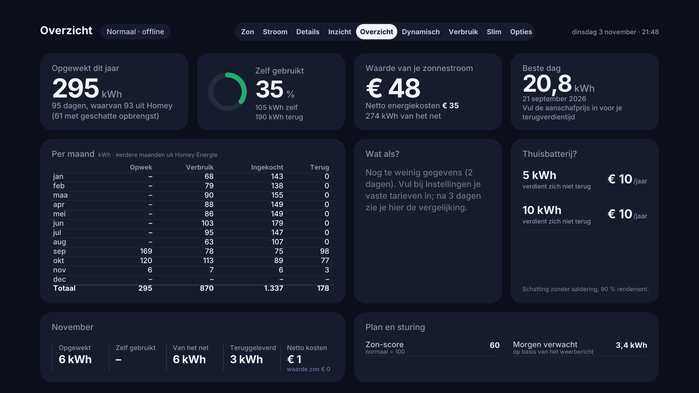</td>
  </tr>
  <tr>
    <td>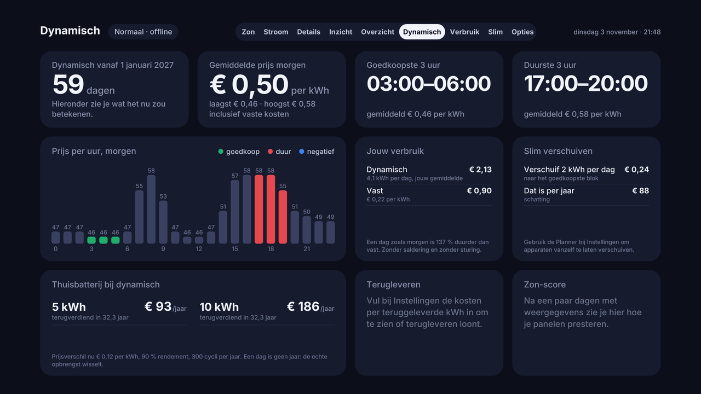</td>
    <td>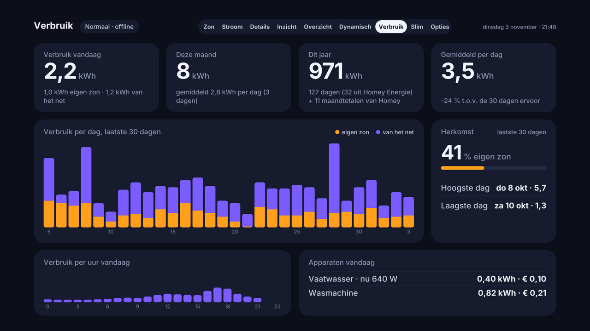</td>
  </tr>
  <tr>
    <td>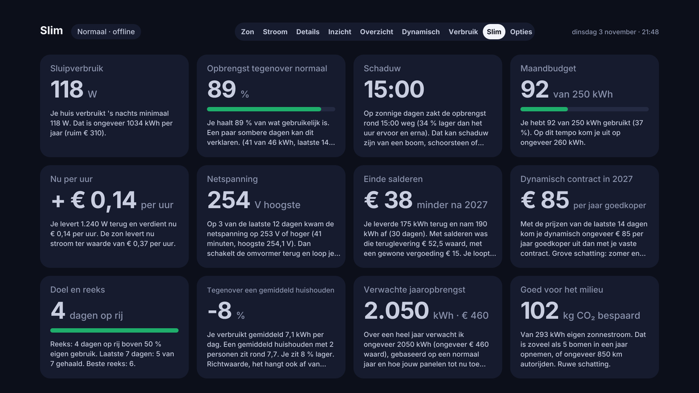</td>
    <td>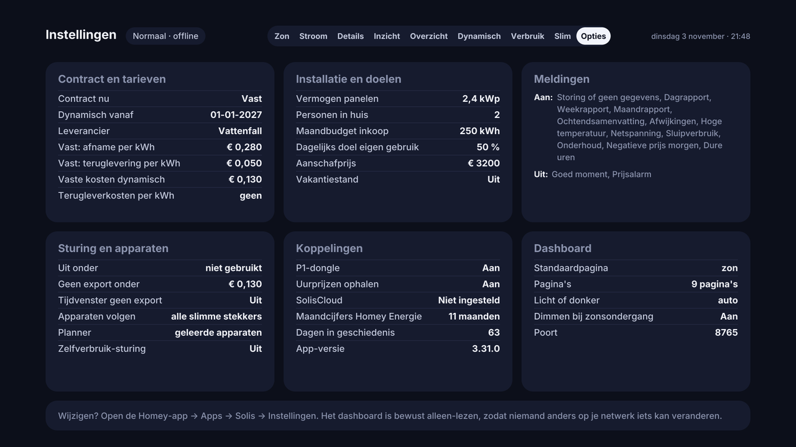</td>
  </tr>
</table>

Screenshots use sample data.

### Display modes

Choose one in the add-on settings under **Display**:

1. **Image from the Homey app** (default, recommended). Needs Solis voor Homey **3.35.0 or newer**. The app draws the pages itself, so nothing else has to run.
2. **Image from the image server.** The real web dashboard, pixel for pixel, rendered by a small Node.js server (folder `beeld-server`) on a computer that stays on. Use this if you want the exact web page.
3. **Built-in pages.** Seven simple native Kodi pages drawn with Kodi controls. Needs Solis voor Homey **3.34.0 or newer**.

### Kodi requirements

- Kodi 19 or newer (tested on CoreELEC with Kodi 22), Python 3
- The Homey app **Solis voor Homey** on a Homey Pro, reachable from the TV on your local network (default port **8765**)

### Install the Kodi add-on (with automatic updates)

Install the **Solis Repository** once. After that Kodi fetches and updates the add-on by itself.

1. Download `repository.solis-1.0.0.zip` from this repository. Do not unzip it.
2. Put the file on your device, for example over SMB to the `Userdata` folder of CoreELEC.
3. In Kodi enable **Settings, System, Add-ons, Unknown sources**.
4. Choose **Add-ons, Install from zip file**, pick the file.
5. Choose **Add-ons, Install from repository, Solis Repository, Program add-ons, Solis Dashboard, Install**.
6. Open **Add-ons, Program add-ons, Solis Dashboard, Configure**.

On Fire TV or Android you can fetch the file with the **Downloader** app:
`https://github.com/djdirty60/Solis-Kodi/raw/main/repository.solis-1.0.0.zip`

### Settings

- **Display**: image from the Homey app, image from the image server, or built-in pages.
- **Dashboard address and port**: the IP address of your Homey and port 8765.
- **Image server address and port**: only for display mode 2.
- **Refresh every (seconds)**, **switch page automatically every (seconds, 0 = off)** and **start page**.

Controls: left and right change page, OK opens the appliances menu, Info (`i`) shows the day review, up and down zoom, the colour buttons jump to a page, Back closes the add-on. See "Extras on the TV" below.

### Notifications on the TV

Version 2.2.0 of the add-on includes a small background service. Every 30 seconds it asks the Solis app on your Homey for new messages and shows each one as a Kodi notification in the corner of the screen, also while you watch a film. Examples: "Washing machine done", "Negative electricity price, start the dishwasher", "Inverter offline".

It starts by itself when Kodi starts. Old messages are never replayed: only messages that arrive after Kodi has started are shown.

Settings (add-on settings, category **Notifications**):

- **Notifications on the TV**: on or off (default on).
- **Show each notification for (seconds)**: default 8.
- **Do not notify while a video is playing**: off by default.
- **Only warnings and good moments**: hides plain information messages.

Needs a Solis voor Homey version that serves `/meldingen.json` (the newest app version).

### Arm appliances from the TV (PIN)

Press **OK** on the dashboard to open the **Apparaten** menu. It lists the appliances the Solis app tracks (for example the washing machine). Pick one to arm it ("ready, start when solar or cheap power allows"); pick one that is already armed to cancel it. A PIN protects this. Set the PIN first in the Solis app (Settings, Dashboard); without a PIN the menu only shows a hint.

In the add-on settings (category **Appliances**) you can store the PIN so you are not asked each time. Leave it empty to be asked every time (hidden input). A wrong PIN is never cleared from the settings, and after too many wrong attempts the Homey asks you to wait. The PIN is never written to the Kodi log.

Needs a Solis voor Homey version that serves `/apparaten.json` and `/arm`.

### Screensaver

The separate add-on **Solis Dashboard Screensaver** shows the dashboard on the TV when nobody is using it. It rotates through the pages you choose (default Stroom, Zon, Details and Verbruik), refreshes the picture every few seconds and dims it at night (23:00 to 06:00). Any key closes it. If the Homey cannot be reached it shows a quiet black screen with a small message and tries again.

1. Install it from the repository: **Add-ons, Install from repository, Solis Repository, Screensaver, Solis Dashboard Screensaver, Install**.
2. Open its settings and enter the address of your Homey (port 8765), seconds per page and which pages to show.
3. Go to **Settings, Interface, Screensaver**, choose **Solis Dashboard Screensaver** and set the **Wait time** (the inactivity time before it starts).

Needs Solis voor Homey 3.35.0 or newer.

### Extras on the TV (2.4.0)

All settings are under **TV extras** in the add-on settings.

- **Mini card during a film.** A small card at the bottom right shows solar, house and grid power, refreshes every 2 seconds and closes by itself after a few seconds (default 8) or on Back/OK. Bind it to a remote button with a keymap, for example in `userdata/keymaps/solis.xml`:

  ```xml
  <keymap><global><remote>
    <blue>RunScript(script.solis.dashboard,minikaart)</blue>
  </remote></global></keymap>
  ```

  Needs Solis voor Homey 3.37.0 or newer (`/lucent.json`).
- **Coloured edge (experimental, not recommended).** Thin coloured edge around the screen. On some systems this can freeze Kodi, so it lives under *Experimental*, is off by default, and switches itself off after a crash (a flag file `edge_started` in the add-on data folder; delete it to try again).
- **Colour buttons.** Red, green, yellow and blue jump to a page you choose (default Sun, Power, Dynamic, Usage). Whether the buttons reach Kodi depends on your remote and keymap.
- **Day review.** Press `i` (Info) in the dashboard to see yesterday: generated, usage, bought, fed back, self-use and savings. Left and right go one day back or forward, Back closes it.
- **Zoom.** Up zooms in on the top half of the page, down on the bottom half; the opposite key goes back.
- **Large text.** Bigger labels on the built-in pages and the mini card; the image pages are shown slightly larger.

### Box LED as traffic light (2.5.0)

Most CoreELEC boxes have a light that Kodi can control through `/sys/class/leds`. Choose *LED light of the box* in the settings:

- **Three LEDs** (red, green, yellow): fill in the LED names.
- **One RGB LED**: fill in the names of the red, green and blue channels.
- **Light bar** (2.6.0): for boxes whose LEDs are all white, like the light bar of a Fire TV Cube 3 running CoreELEC (`led1` to `led15`). Green = all LEDs on, orange = the middle half, red = the middle 3. Fill in the start of the LED names (default `led`).
- **One LED**: steady = green, slow blink (heartbeat) = orange, fast blink (timer) = red.

Use *Show which LEDs this box has* to see the names. The light follows the traffic light of the Solis app every 30 seconds, switches off when the connection drops and (optionally) at night 23:00-07:00, and returns to its original state when Kodi quits. It needs a system where Kodi may write to `/sys/class/leds` (CoreELEC runs as root, so yes). It does **not** work when the box runs Android / Fire OS (apps cannot touch the light bar there). A Fire TV Cube that dual-boots into CoreELEC is a different case: it may work there if the kernel exposes the light bar as an LED. Run *Show which LEDs this box has* to find out; if it lists nothing, the light bar is not available as an LED.

## How it works

The Solis app on Homey serves everything on its dashboard port (default 8765):

- `/beeld/pages.json` lists the pages.
- `/beeld/page/<page>.png` returns a 1920 x 1080 image of a page, drawn by a small rendering module in the app (no browser, no native libraries).
- `/kodi.json` returns the data for the built-in pages.
- `/meldingen.json?since=<id>` returns new notifications for the TV service.
- `/apparaten.json` and `POST /arm` list and arm appliances (PIN protected).

You can open the image URLs in any browser to check them, for example `http://HOMEY-IP:8765/beeld/page/stroom.png`.

## Troubleshooting

- **"No connection to the image source"**: check the Homey address in the add-on settings, and that the Solis app is 3.35.0 or newer.
- **Old picture stays on screen**: update the add-on to 2.1.1 or newer.
- **Inverter shows "offline" at night**: that is normal. The inverter and the data logger sleep without sun.
- **"Omvormer niet bereikbaar" during the day**: give the data logger a fixed IP address in your router (it can get a new address otherwise), and check that it is an S2-WL-ST.

## Security

The dashboard is read-only. You can set a password for it in the app (Settings, Dashboard); the TV pages can be protected with a separate token. The image server has no password. Do not expose their ports to the internet; use them on your own network.

## Releasing a new version (for the maker)

Kodi add-on:

1. Raise the version in `script.solis.dashboard/addon.xml` and add a line to `changelog.txt`.
2. Run `python3 tools/make_repo.py`.
3. Commit and push, including the `repo` folder. Kodi usually sees the update within the hour.

The image server (folder `beeld-server`) is not updated by Kodi; replace its files on your computer when there is a new version.

Homey app and TV apps: put the new zip, APK or IPA in `homey-app/` or `tv-apps/downloads/` and raise the numbers in `tv-apps/versie.json`. The apps read that file to announce updates.

## License

MIT
